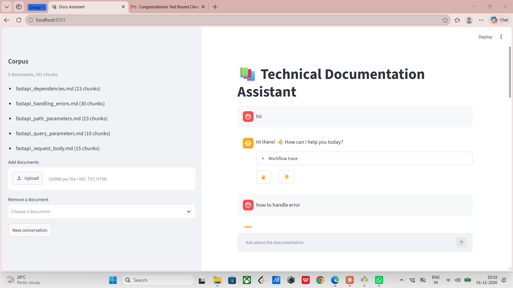
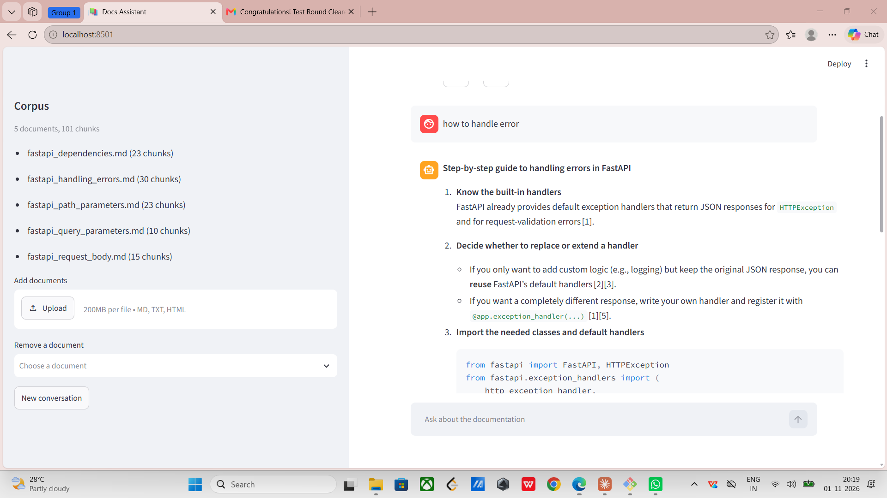
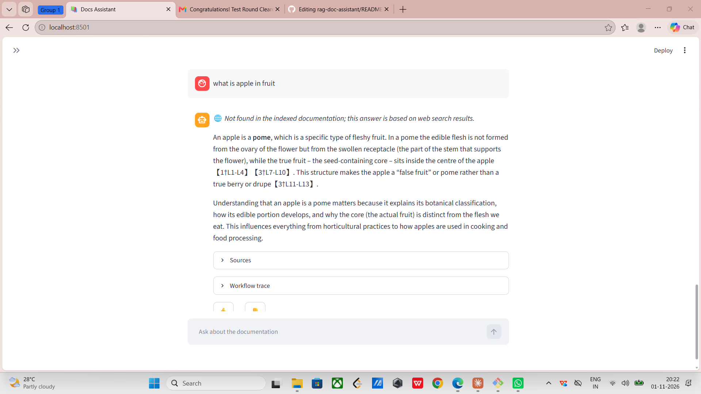
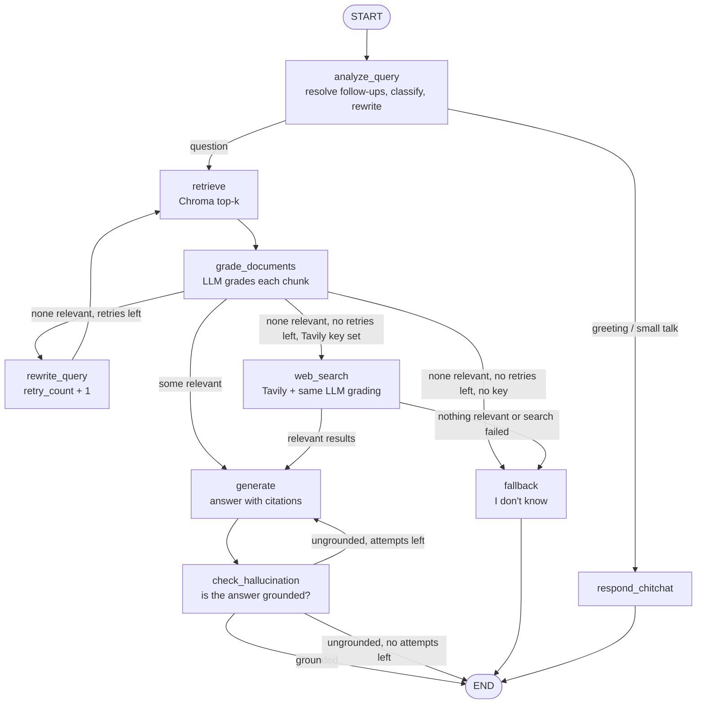

# RAG Technical Documentation Assistant

A Retrieval-Augmented Generation assistant that answers questions about the
official **FastAPI tutorial** docs. A self-corrective **LangGraph** workflow
analyses the question, retrieves chunks, has an LLM grade them, rewrites the
query and retries when nothing is relevant, and generates an answer with
citations. It is served through **FastAPI**, with an optional Streamlit UI.

**Stack:** Python · LangGraph · FastAPI · ChromaDB · sentence-transformers
(`all-MiniLM-L6-v2`) · Groq (`gpt-oss-120b` / `gpt-oss-20b`) · Streamlit

**Bonus features (all implemented):** hallucination check · web search
fallback (Tavily) · conversation memory · Streamlit UI

## Screenshots

**Chat UI with the indexed corpus.** A greeting is answered directly, without retrieval:



**Answer with citations** ("how to handle error"), generated only from the graded chunks of `fastapi_handling_errors.md`:



**Web search fallback (bonus).** An off-topic question finds nothing relevant in the docs; after the retries, the answer comes from graded web results and is labelled as such:



---

## Architecture



| Node | Role |
|---|---|
| `analyze_query` | Resolves follow-ups using chat history, classifies the question (conceptual, how-to, troubleshooting, api-reference, chitchat) and writes an expanded search query |
| `retrieve` | Top-k similarity search in ChromaDB. The first attempt searches both the expanded query and the original question |
| `grade_documents` | LLM grades **each** chunk relevant / irrelevant and keeps only the relevant ones |
| `rewrite_query` | Runs when nothing is relevant: writes a new query, different from those already tried |
| `generate` | Answers only from the relevant chunks, citing them as `[1]`, `[2]` |
| `check_hallucination` | *(bonus)* Checks that the answer is supported by the chunks; regenerates once if not |
| `web_search` | *(bonus, optional)* Tavily search once retries are used up; results go through the same grading |
| `fallback` | Returns "I don't know" when nothing relevant is found |
| `respond_chitchat` | Greetings and "which files do you have?" are answered without retrieval |

### State schema and retry tracking

Defined in `app/graph/state.py`:

- **`question` is never modified.** The workflow answers and grades against
  `standalone_question` (follow-ups resolved), and searches with
  `rewritten_query`. Grading uses the question, not the search query, so a bad
  rewrite cannot make irrelevant chunks look relevant.
- **`retry_count`** is set to 0 once by `analyze_query` and increased **only**
  by `rewrite_query`. The retry loop (`rewrite_query → retrieve →
  grade_documents`) never passes through `analyze_query` again, so the counter
  cannot reset and the loop always ends at `max_retries` (default 2).
- **`search_queries`** appends every query tried (LangGraph reducer), so a
  rewrite never repeats a failed query.
- **`documents`** and **`relevant_documents`** are kept separately, so you can
  see what the grader filtered out.
- The hallucination check has its own counter (`generation_count`), and
  `web_search_used` makes web search run at most once.
- **`steps`** records the path taken and is returned by the API as a trace.

---

## Setup

Requires Python 3.11+ and a free [Groq API key](https://console.groq.com/keys).

```bash
python -m venv .venv
.venv\Scripts\activate            # macOS/Linux: source .venv/bin/activate
pip install -r requirements.txt
cp .env.example .env              # then set GROQ_API_KEY
python ingest.py                  # builds the vector store from data/documents/
```

Optional: set `TAVILY_API_KEY` in `.env` to enable the web search fallback.

## Run

```bash
uvicorn app.main:app --port 8000                # API, docs at http://localhost:8000/docs
streamlit run ui/streamlit_app.py               # UI at http://localhost:8501
pytest                                          # 35 offline tests (fake LLM, no API key needed)
```

---

## API

| Method | Endpoint | Purpose |
|---|---|---|
| POST | `/query` | Ask a question → answer, cited sources, workflow trace |
| POST | `/ingest` | Upload `.md` / `.txt` / `.html` files and/or URLs |
| GET | `/documents` | List indexed documents with chunk counts |
| POST | `/feedback` | Thumbs up/down + optional comment for a `query_id` |
| DELETE | `/documents?source=…` | Remove a document (extra) |
| DELETE | `/sessions/{id}` | Clear conversation memory (extra) |
| GET | `/health` | Status and number of indexed chunks |

Errors use meaningful status codes: 400 (no input), 404 (unknown id or
document), 409 (nothing indexed), 422 (invalid input), 502 (LLM call failed),
503 (API key missing).

### Example: answered question

```bash
curl -X POST localhost:8000/query -H "Content-Type: application/json" \
  -d '{"question": "How do I make a query parameter optional?", "session_id": "demo"}'
```

```json
{
  "query_id": "217e542c-c3c9-4388-8db6-b79eccdc6fe2",
  "answer": "To make a query parameter optional, give it a default value (commonly `None`) ... `q: str | None = None` ... [2][3]",
  "sources": [
    {"id": 2, "filename": "fastapi_query_parameters.md", "section": "Query Parameters > Optional parameters", "score": 0.5077, "snippet": "..."},
    {"id": 3, "filename": "fastapi_request_body.md", "section": "Request Body > Request body + path + query parameters", "score": 0.503, "snippet": "..."}
  ],
  "status": "answered",
  "grounded": true,
  "query_type": "how-to",
  "retries": 0,
  "used_web_search": false,
  "steps": [
    "analyze_query: type=how-to, query='FastAPI optional query parameter default None ...'",
    "retrieve: 5 chunks for '...' + 0 new for the original question",
    "grade_documents: 5/5 relevant",
    "generate: attempt 1",
    "check_hallucination: grounded=True"
  ]
}
```

### Example: question the corpus cannot answer

`"How do I train a convolutional neural network in PyTorch?"` (no Tavily key):

```json
{
  "answer": "I don't know. I couldn't find information about this in the indexed documentation, so I'd rather not guess. ...",
  "sources": [],
  "status": "no_relevant_documents",
  "retries": 2,
  "search_queries": [
    "train convolutional neural network using PyTorch tutorial steps model definition optimizer loss function training loop",
    "PyTorch CNN training example code with DataLoader and training loop",
    "PyTorch CNN training pipeline data augmentation loss function optimizer backward pass example"
  ],
  "steps": ["analyze_query", "retrieve", "grade_documents (0 relevant)",
            "rewrite_query (retry 1)", "retrieve", "grade_documents (0 relevant)",
            "rewrite_query (retry 2)", "retrieve", "grade_documents (0 relevant)",
            "fallback: no relevant documents after 2 retries"]
}
```

With `TAVILY_API_KEY` set, the same question ends with
`web_search: 5/5 results relevant`, an answer citing the web pages, and
`"used_web_search": true`.

### Example: ingest, documents, feedback

```bash
curl -X POST localhost:8000/ingest -F "files=@my_guide.md" -F "urls=https://example.com/page.html"
# 201 {"ingested": [{"source": "data/documents/my_guide.md", "chunks": 2}, ...], "failed": [], "total_chunks": ...}

curl localhost:8000/documents
# {"total_documents": 5, "total_chunks": 101, "documents": [{"filename": "fastapi_dependencies.md", "chunks": 23}, ...]}

curl -X POST localhost:8000/feedback -H "Content-Type: application/json" \
  -d '{"query_id": "<query_id from /query>", "rating": "up", "comment": "clear answer"}'
# 201 {"message": "Feedback recorded.", ...}   (stored in data/feedback.jsonl)
```

---

## Write-up

### Thought process

The brief says the state schema and retry tracking are the core of the
evaluation, so I designed the state before writing the nodes: what each node
reads, what it writes, and what must never be overwritten. The workflow follows
the Corrective-RAG pattern, with one job per node:

1. **Analyse before retrieving.** Short, vague questions retrieve poorly, so
   the question is expanded into a technical search query. The same call
   classifies it, which sets the answer style and lets small talk skip
   retrieval.
2. **Grade with an LLM.** Vector search always returns *something*, even for
   unrelated questions. Grading turns "closest text" into "relevant text", and
   is the signal that decides whether to answer, retry or stop.
3. **Retry with a different query, but bounded.** The usual cause of a miss is
   vocabulary mismatch, so the rewrite sees the failed queries and tries new
   terms. The limit guarantees an honest "I don't know" instead of a guess.
4. **Generate only from graded chunks, with citations,** then **check the
   answer** against those chunks (bonus).

### Chunking and embedding strategy

- **Split by Markdown headings first** (`#`, `##`, `###`): docs are already
  organised by topic, so a chunk never mixes two topics.
- **Then by size:** sections over **800 characters** are split with
  `RecursiveCharacterTextSplitter` (**150 overlap**), preferring code-block,
  paragraph, line and sentence boundaries. 800 characters fits most doc
  sections and a whole code example; the overlap keeps sentences that cross a
  split.
- **Each chunk is prefixed with its heading path** (e.g. `Handling Errors >
  Add custom headers`), which gives the embedding context and is shown as the
  citation.
- I wrote a small heading splitter instead of LangChain's
  `MarkdownHeaderTextSplitter`, because that one strips leading whitespace and
  destroyed the indentation of the Python examples.
- **Embeddings:** `all-MiniLM-L6-v2` runs locally on CPU: free, no API key, no
  rate limit, small enough for a laptop. **Vector store:** ChromaDB, local and
  persistent, with metadata for listing and deleting documents.
- Result: 5 pages → 101 chunks (median ~550 characters).

### Corpus

Five pages of the [FastAPI tutorial](https://fastapi.tiangolo.com/tutorial/)
in `data/documents/`: path parameters, query parameters, request body, handling
errors, dependencies. `python -m scripts.fetch_corpus` re-downloads them and
inlines the Python examples, which the original pages pull in from separate
files.

### Design decisions and tradeoffs

- **Two Groq models.** The free tier limits tokens per model, and one question
  makes about 8 LLM calls. Simple yes/no tasks (grading, rewriting, the
  hallucination check) use the small `gpt-oss-20b`; analysis and answers use
  `gpt-oss-120b`.
- **Structured outputs** (Pydantic schemas) for every LLM decision instead of
  parsing free text.
- **Grade each chunk separately** (as specified): more calls, but each decision
  is independent and visible. The calls run concurrently.
- **Retry, then "I don't know"** rather than answering from weak context: for
  documentation, a confident wrong answer is worse than no answer.
- **Search the original question too on the first attempt:** query expansion
  sometimes pushed the best chunk out of the top 5, so both are searched and
  merged. Costs a few extra grading calls.
- **Regenerate an ungrounded answer only once,** then return it flagged
  `ungrounded`, to bound latency and cost.
- **Local embeddings:** free and private, but weaker than large hosted models
  on technical vocabulary.
- **In-memory session memory:** simple, but lost on restart.

### Assumptions

- A small, English corpus of Markdown, text or HTML documents.
- One user per `session_id`; sessions don't need to survive a restart.
- The app runs locally, so there is no authentication, and `/ingest` trusts
  the URLs it is given.

### Known limitations

- **Over-strict grading on some reference questions.** "What parameters does
  HTTPException accept?" returns "I don't know": the relevant chunks are
  retrieved, but the small grading model doesn't count usage examples like
  `HTTPException(status_code=404, detail=...)` as answering the question.
- **Free-tier rate limits.** Groq allows ~200k tokens/day on the grading model;
  heavy testing can exhaust it, and the API then returns 502.

### What I would improve with more time

1. **An evaluation set** (30–50 questions with expected sources) to measure
   retrieval hit rate and answer faithfulness, and tune chunk size, k and the
   grading prompt with data.
2. **Hybrid search + reranking:** keyword (BM25) plus vector search, then a
   cross-encoder reranker, so exact names like `HTTPException` rank higher.
3. **A stronger grading model** or a better grading prompt for the limitation above.
4. **Persistence:** LangGraph checkpointer for conversations, a database for
   feedback.
5. **Streaming responses** and tracing (LangSmith).

---

## Project structure

```
app/
  main.py            FastAPI app
  config.py          settings (overridable in .env)
  api/               routes.py (endpoints), schemas.py (validation)
  graph/             state.py, nodes.py, edges.py, workflow.py (LangGraph)
  services/          document_loader, vector_store, llm, memory, feedback, web_search
data/documents/      the corpus
ingest.py            ingestion script
scripts/             fetch_corpus.py (download corpus), check_retrieval.py
ui/streamlit_app.py  Streamlit UI
tests/               offline tests: routing, workflow, chunking, API
```
