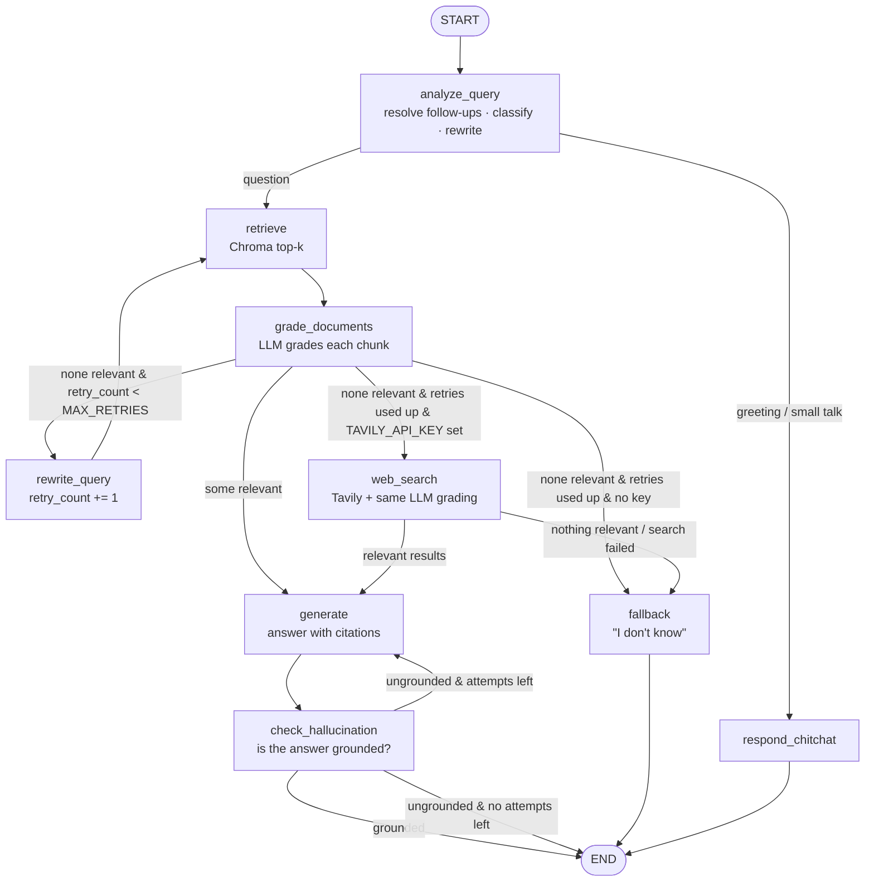

# RAG Technical Documentation Assistant

A Retrieval-Augmented Generation (RAG) assistant that answers questions about a
technical documentation corpus, here the official **FastAPI tutorial** docs. It uses a **self-corrective LangGraph workflow**
(query analysis → retrieval → LLM document grading → query rewrite & retry →
generation with citations → hallucination check) and is served through **FastAPI**.

**Stack:** Python · LangGraph · LangChain · ChromaDB · sentence-transformers
(`all-MiniLM-L6-v2`) · Groq (`gpt-oss-120b` / `gpt-oss-20b`) · FastAPI · Streamlit

| Requirement | Where |
|---|---|
| Query analysis node (rewrite + classify) | `app/graph/nodes.py` → `analyze_query` |
| Retrieval node (top-k + metadata) | `retrieve` |
| Document grading node (LLM, per chunk) | `grade_documents` |
| Generation node with citations | `generate` |
| Conditional edge + retry limit | `app/graph/edges.py` → `route_after_grading` |
| State schema | `app/graph/state.py` |
| Ingestion pipeline | `ingest.py`, `app/services/document_loader.py` |
| `POST /query`, `POST /ingest`, `GET /documents`, `POST /feedback` | `app/api/routes.py` |
| **Bonus:** hallucination check (Self-RAG) | `check_hallucination` + `route_after_hallucination_check` |
| **Bonus:** conversation memory | `session_id` on `/query`, `app/services/memory.py` |
| **Bonus:** simple UI | `ui/streamlit_app.py` |
| **Bonus:** web search fallback (Tavily, optional) | `web_search` + `route_after_web_search`, `app/services/web_search.py` |

---

## Thought process

I started from the brief's hint that the **state schema and retry tracking** are
the core of the evaluation, and designed the state before writing nodes. The
question I kept asking was: *what does each node need to read, what does it
write, and what must never be overwritten?* That led to keeping the user's
`question` immutable, separating what we **search with** (`rewritten_query`)
from what we **answer and grade against** (`standalone_question`), and giving
each loop its own counter that only one node can increment.

The pipeline follows the Corrective-RAG pattern from the LangGraph tutorials,
with each node doing one job:

1. **Analyze before retrieving.** Users write short, vague questions;
   embeddings work better with expanded, technical queries. The same LLM call
   also classifies the question, which is used later to choose the answer style
   and to skip retrieval entirely for small talk.
2. **Retrieve generously, then filter with an LLM.** Vector similarity always
   returns *something*, even for unrelated questions. Grading each chunk is
   what turns "closest text" into "relevant text", and it is the signal the
   graph uses to decide whether to answer, retry or give up.
3. **Retry with a different query, but boundedly.** If nothing is relevant, the
   most common cause is vocabulary mismatch, so the rewrite node sees every
   query that already failed and tries different terms. The retry limit ensures
   a question the corpus can't answer ends in an honest "I don't know".
4. **Generate only from what survived grading, and cite it.** Numbered passages
   make citations checkable, and only the cited sources are returned.
5. **Check the answer, not just the inputs** (bonus). Grading verifies the
   context; the hallucination check verifies that the answer stayed within it.

Practical constraints shaped the rest: Groq's free-tier rate limits led to the
two-model split, and a small local machine led to local CPU embeddings and a
lightweight Chroma store.

## Architecture



### Nodes

| Node | What it does | Model |
|---|---|---|
| `analyze_query` | Uses chat history to turn follow-ups into a **standalone question**, classifies it (`conceptual`, `how-to`, `troubleshooting`, `api-reference`, `chitchat`) and writes an expanded **search query** (synonyms, technical terms). Structured output via Pydantic. | main |
| `retrieve` | Similarity search in ChromaDB with the current search query. Returns top-k chunks with `source`, `filename`, `section`, `score`. | — |
| `grade_documents` | Grades **each** chunk `relevant`/`irrelevant` with the LLM (calls run concurrently) and keeps only the relevant ones. | fast |
| `rewrite_query` | Runs only when nothing was relevant. Sees every query tried so far and writes a *different* one. Increments `retry_count`. | fast |
| `generate` | Answers using only the relevant chunks, numbered `[1]`, `[2]`, … and cites them inline. The answer style depends on `query_type`. Returns only the sources the answer actually cites. | main |
| `check_hallucination` | Self-RAG style check that every claim is supported by the context. If not, `generate` runs again with the checker's feedback, once. | fast |
| `web_search` | *Optional, only when `TAVILY_API_KEY` is set.* Runs at most once, after the corpus retries are used up. Web results go through the **same LLM grading** as corpus chunks, and their URLs become the citations. If the search fails or nothing is relevant, it falls back to the node below. | fast |
| `respond_chitchat` | Greetings, small talk and questions about the assistant or corpus ("hi", "which files do you have?") are classified `chitchat` and skip retrieval. One small LLM call replies, given the real list of indexed files, and is told not to answer technical questions from its own knowledge. This saves ~15 LLM calls compared with sending "hi" through retrieval and grading. | fast |
| `fallback` | Retries are used up and nothing was relevant: returns an honest "I don't know" with no sources. | — |

### State schema (`app/graph/state.py`)

The brief calls this out as a core criterion, so here are the decisions behind it:

- **`question` is never modified.** Derived values live in their own fields:
  `standalone_question` (what we answer and grade against) and `rewritten_query`
  (what we search with). Debugging stays simple because you can always see what
  the user asked, what we understood, and what we searched for.
- **Grading uses `standalone_question`, not the search query.** If grading used
  the rewritten query, a bad rewrite could make irrelevant chunks look relevant.
- **`retry_count` is set to 0 exactly once** (in `analyze_query`, which runs once)
  and **only `rewrite_query` increments it**. The loop is
  `rewrite_query → retrieve → grade_documents`, which never passes through
  `analyze_query` again, so the counter can't be reset and the loop always ends.
  `max_retries` can be set per request (default from `MAX_RETRIES`).
- **`search_queries` uses an append reducer** (`Annotated[list, operator.add]`),
  so the rewrite node sees every query that already failed and doesn't repeat one.
- **`documents` and `relevant_documents` are separate**, so you can see what the
  grader filtered out.
- **`web_search_used`** makes sure the web search runs at most once per question.
- **The hallucination loop has its own counter** (`generation_count` /
  `max_generations`), independent of the retrieval retries.
- **`steps`** (append reducer) is an execution trace returned by the API. It shows
  exactly which path the graph took.

---

## Ingestion and chunking strategy

`python ingest.py` loads everything in `data/documents/` (`.md`, `.txt`,
`.html`). `POST /ingest` does the same for uploaded files or URLs.

1. **Load:** Markdown/text are read as-is. HTML is cleaned with BeautifulSoup
   (scripts, nav and footers removed), and its `<h1>`–`<h3>` become Markdown
   headings so HTML gets the same section-aware splitting.
2. **Split by structure first:** sections are split on `#`/`##`/`###`
   headings. Technical docs are already organised by topic, so a section is a
   natural semantic unit and a chunk never mixes two topics (e.g. "Optional
   parameters" and "Required query parameters"). I wrote a small splitter
   (`split_markdown_sections`) instead of LangChain's `MarkdownHeaderTextSplitter`,
   because that one strips whitespace from every line and destroyed the
   indentation of the Python examples. Mine keeps lines verbatim and ignores
   `#` lines inside code blocks, so Python comments are not mistaken for headings.
3. **Then by size:** sections longer than **800 characters** are split further
   with `RecursiveCharacterTextSplitter` (150 overlap), trying code fences, then
   paragraphs, lines and sentences. This keeps code examples and lists whole
   where possible.
4. **Contextual headers:** each chunk is prefixed with its heading path (e.g.
   `Handling Errors > Use HTTPException > Raise an HTTPException in your code`). A
   chunk that is just a code snippet then still embeds close to questions about
   its topic, and the path is shown to the user as the citation's section.
5. **Embed:** `sentence-transformers/all-MiniLM-L6-v2` runs locally on CPU
   (free, no API key, 384 dims, fast), with normalised embeddings.
6. **Store:** persistent ChromaDB. IDs are deterministic (`uuid5` of source +
   index + content). Re-ingesting upserts the new chunks first and **then**
   deletes the source's stale chunks, so editing a file never leaves outdated
   chunks behind, and a failed embedding run never deletes the old version.

**Why 800 / 150?** Most sections in API-style docs fit in 800 characters, so
usually one section becomes one chunk. That's small enough to grade precisely
and to fit 5 chunks in the prompt cheaply, and large enough to hold a whole code
example. The 150 overlap keeps sentences that cross a split point.

**Result on this corpus:** 5 pages → 101 chunks (median ~550 characters,
max ~860), 37 of which contain complete, correctly indented Python examples.

### Corpus

Five pages of the official [FastAPI tutorial](https://fastapi.tiangolo.com/tutorial/),
stored in `data/documents/` (~49 KB in total):

| File | Page | Chunks |
|---|---|---|
| `fastapi_path_parameters.md` | [Path Parameters](https://fastapi.tiangolo.com/tutorial/path-params/) | 23 |
| `fastapi_query_parameters.md` | [Query Parameters](https://fastapi.tiangolo.com/tutorial/query-params/) | 10 |
| `fastapi_request_body.md` | [Request Body](https://fastapi.tiangolo.com/tutorial/body/) | 15 |
| `fastapi_handling_errors.md` | [Handling Errors](https://fastapi.tiangolo.com/tutorial/handling-errors/) | 30 |
| `fastapi_dependencies.md` | [Dependencies](https://fastapi.tiangolo.com/tutorial/dependencies/) | 23 |

`python -m scripts.fetch_corpus` re-downloads them from the
[fastapi/fastapi](https://github.com/fastapi/fastapi) repo. The source pages use
MkDocs syntax, so the script converts them to plain Markdown: `{* ../../docs_src/... *}`
include tags are replaced with the **actual Python example code** (otherwise the
corpus would contain no code at all), `/// tip` blocks become **Tip:** paragraphs,
and heading anchors and inline HTML are removed.

Why FastAPI: it's a well-known Python framework, the docs mix prose with
many code examples (a realistic chunking challenge), and it's the framework this
project is built with. Add more documents by uploading files or URLs to
`POST /ingest`, or by putting files in `data/documents/` and re-running
`python ingest.py`. If you change the topic, also set `CORPUS_DESCRIPTION` in
`.env`; the query-analysis prompt uses it to write queries in the corpus's
vocabulary.

---

## Setup

Requires Python 3.11+ (developed on 3.13).

```bash
python -m venv .venv
.venv\Scripts\activate            # Windows   (macOS/Linux: source .venv/bin/activate)
pip install -r requirements.txt
cp .env.example .env              # then set GROQ_API_KEY (free at console.groq.com)
python -m scripts.fetch_corpus    # optional: the docs are already in data/documents/
python ingest.py                  # builds data/chroma_db (downloads the embedding model once)
```

## Run

```bash
uvicorn app.main:app --reload --port 8000
```

- Interactive API docs: http://localhost:8000/docs
- UI (optional, in a second terminal): `streamlit run ui/streamlit_app.py`
- Web search fallback (optional): add `TAVILY_API_KEY` to `.env` (free tier: 1,000 searches/month)
- Tests (offline, no API key needed, fake LLM): `pytest`
- Retriever-only check: `python -m scripts.check_retrieval "your question"`

---

## API

| Method | Endpoint | Purpose | Status codes |
|---|---|---|---|
| POST | `/query` | Ask a question; returns answer, cited sources and the workflow trace | 200, 409 (nothing indexed), 422 (invalid input), 502 (LLM error), 503 (no API key) |
| POST | `/ingest` | Upload `.md/.txt/.html` files and/or URLs (multipart) | 201, 400 (no input), 422 (nothing ingestible); partial failures listed in `failed` |
| GET | `/documents` | List indexed documents with chunk counts | 200 |
| DELETE | `/documents?source=…` | Remove a document from the index | 200, 404 |
| POST | `/feedback` | Thumbs up/down + optional comment for a `query_id` | 201, 404 (unknown id), 422 |
| DELETE | `/sessions/{id}` | Clear conversation memory | 204, 404 |
| GET | `/health` | Liveness + number of indexed chunks | 200 |

### Example: an answerable question

```bash
curl -X POST localhost:8000/query -H "Content-Type: application/json" \
  -d '{"question": "How do I make a query parameter optional?", "session_id": "demo"}'
```

```json
{
  "query_id": "217e542c-c3c9-4388-8db6-b79eccdc6fe2",
  "question": "How do I make a query parameter optional?",
  "answer": "To make a query parameter optional, give it a default value (commonly `None`). FastAPI treats any parameter that has a default as optional, so the request can omit it without causing a validation error.\n\n**Step‑by‑step**\n\n1. Import FastAPI and create the app.  \n2. Define the endpoint function.  \n3. Add the query parameter with a type annotation and set `= None` (or any other default you prefer).\n\n```python\nfrom fastapi import FastAPI\n\napp = FastAPI()\n\n@app.get(\"/items/{item_id}\")\nasync def read_item(item_id: str, q: str | None = None):\n    if q:\n        return {\"item_id\": item_id, \"q\": q}\n    return {\"item_id\": item_id}\n```\n\n- `q` is a **query** parameter because it is a singular type (`str`).  \n- The `= None` default makes it optional; if the client does not provide `q`, FastAPI sets it to `None` [2][3].\n\n**Result**  \nCalling `GET /items/123` returns `{\"item_id\": \"123\"}` (no `q`).  \nCalling `GET /items/123?q=hello` returns `{\"item_id\": \"123\", \"q\": \"hello\"}`.",
  "sources": [
    {
      "id": 2,
      "source": "data/documents/fastapi_query_parameters.md",
      "filename": "fastapi_query_parameters.md",
      "section": "Query Parameters > Optional parameters",
      "score": 0.5077,
      "snippet": "Query Parameters > Optional parameters  The same way, you can declare optional query param ..."
    },
    {
      "id": 3,
      "source": "data/documents/fastapi_request_body.md",
      "filename": "fastapi_request_body.md",
      "section": "Request Body > Request body + path + query parameters",
      "score": 0.503,
      "snippet": "Request Body > Request body + path + query parameters  ```  The function parameters will b ..."
    }
  ],
  "status": "answered",
  "grounded": true,
  "query_type": "how-to",
  "search_queries": [
    "FastAPI optional query parameter optional query parameter default None typing Optional"
  ],
  "retries": 0,
  "used_web_search": false,
  "steps": [
    "analyze_query: type=how-to, query='FastAPI optional query parameter optional query parameter default None typing Optional'",
    "retrieve: 5 chunks for 'FastAPI optional query parameter optional query parameter default None typing Optional'",
    "grade_documents: 5/5 relevant",
    "generate: attempt 1",
    "check_hallucination: grounded=True"
  ],
  "session_id": "demo"
}
```

### Example: a question the corpus can't answer (self-correction path)

`"How do I train a convolutional neural network in PyTorch?"` →

```json
{
  "answer": "I don't know. I couldn't find information about this in the indexed documentation, so I'd rather not guess. Try rephrasing the question or ingest documentation that covers this topic.",
  "sources": [],
  "status": "no_relevant_documents",
  "grounded": null,
  "query_type": "how-to",
  "retries": 2,
  "used_web_search": false,
  "search_queries": [
    "train convolutional neural network using PyTorch tutorial steps model definition optimizer loss function training loop",
    "PyTorch CNN training example code with DataLoader and training loop",
    "PyTorch CNN training pipeline data augmentation loss function optimizer backward pass example"
  ],
  "steps": [
    "analyze_query: type=how-to, query='train convolutional neural network using PyTorch ...'",
    "retrieve: 5 chunks for '...'",
    "grade_documents: 0/5 relevant",
    "rewrite_query (retry 1): 'PyTorch CNN training example code with DataLoader and training loop'",
    "retrieve: 5 chunks for '...'",
    "grade_documents: 0/5 relevant",
    "rewrite_query (retry 2): 'PyTorch CNN training pipeline data augmentation loss function optimizer backward pass example'",
    "retrieve: 5 chunks for '...'",
    "grade_documents: 0/5 relevant",
    "fallback: no relevant documents after 2 retries"
  ]
}
```

Each rewrite uses different terms from the previous queries, and the loop stops
after `MAX_RETRIES` instead of answering from irrelevant chunks.

### Example: a follow-up question (conversation memory)

In session `demo2`:

1. *"How do I return a 404 error when an item is not found?"* → raises
   `HTTPException(status_code=404, ...)`, citing
   `fastapi_handling_errors.md > Handling Errors > Use HTTPException > Raise an HTTPException in your code`
   (5/5 chunks graded relevant).
2. *"Can I add custom headers to it?"* → "it" is resolved from the history to
   the 404 `HTTPException`. The search query becomes
   `FastAPI add custom response headers HTTPException 404 custom headers`, and the
   answer passes `headers={...}` to `HTTPException`, citing
   `fastapi_handling_errors.md > Handling Errors > Add custom headers`.

### Example: greetings and questions about the corpus

`"hi"` and `"which files do you have?"` are classified `chitchat` and skip
retrieval (`steps: ["analyze_query: type=chitchat ...", "respond_chitchat: no retrieval needed"]`).
The second one lists the five indexed files with their chunk counts.

### Example: ingest, feedback

```bash
curl -X POST localhost:8000/ingest \
  -F "files=@my_guide.md" \
  -F "urls=https://raw.githubusercontent.com/fastapi/fastapi/master/README.md"
# 201 {"ingested":[{"source":"data/documents/my_guide.md","filename":"my_guide.md","chunks":2}, ...],
#      "failed":[], "total_chunks": ...}

curl localhost:8000/documents
# {"total_documents":5,"total_chunks":101,"documents":[{"source":"data/documents/fastapi_dependencies.md","filename":"fastapi_dependencies.md","file_type":".md","chunks":23}, ...]}

curl -X POST localhost:8000/feedback -H "Content-Type: application/json" \
  -d '{"query_id": "<query_id from /query>", "rating": "up", "comment": "clear answer"}'
# 201 {"message":"Feedback recorded.","query_id":"...","rating":"up"}
```

Feedback is appended to `data/feedback.jsonl` together with the question and
answer it refers to, so it can be analysed later (e.g. which questions get 👎).

---

## Design decisions and tradeoffs

- **Two models instead of one.** Groq's free tier allows ~8k tokens/minute *per
  model*, and one query makes about 8 LLM calls (analysis, 5 gradings,
  generation, check, plus rewrites). Grading, rewriting and the hallucination
  check are simple classification tasks, so they go to the smaller
  `gpt-oss-20b`. That spreads the load across two budgets. Generation and query
  analysis use `gpt-oss-120b`. `reasoning_effort="low"` cuts hidden reasoning
  tokens, and the client retries 429s after the time Groq asks for.
- **Per-chunk grading (as specified) rather than one batched prompt.** It is
  more calls, but each decision is independent and easy to inspect. The calls
  run concurrently, so latency stays close to one call.
- **Structured outputs everywhere** (`with_structured_output` + Pydantic +
  `Literal` types) instead of parsing free text. Line-based parsing is fragile:
  it fails silently as soon as the model adds Markdown bold or extra words.
- **Grade against the question, retrieve with the rewritten query** (see the
  state schema section above).
- **Retry and fallback rather than answering from weak context.** For
  documentation, a confident wrong answer costs more than "I don't know".
- **Hallucination check regenerates only once,** then returns the answer with
  `status: "ungrounded"` instead of looping, which limits latency and cost. The
  UI shows a warning for this status.
- **Web search is opt-in and comes last.** The assistant is about *this*
  corpus, so the web is only tried after the corpus retries fail, and web
  results must pass the same relevance grading. `used_web_search` in the
  response tells the client the answer didn't come from the indexed docs.
- **Local embeddings.** Free, private and with no rate limit, but MiniLM is
  weaker than large hosted embedding models on very technical vocabulary.
- **In-memory session memory and query log.** Simple and enough for a demo, but
  lost on restart and not shared across workers.
- **Sync endpoints.** FastAPI runs them in a thread pool. Simpler than async
  LangGraph and fine at this scale.

## Assumptions

- The corpus is small (tens of documents), English, Markdown/text/HTML.
- One user per `session_id`; sessions don't need to survive a restart.
- URLs given to `/ingest` are public documentation pages. There is no
  authentication or SSRF protection, because this is meant to run locally.

## What I would improve with more time

1. **Evaluation set.** 30–50 question/answer pairs with expected sources, plus
   metrics (retrieval hit-rate@k, grading precision, faithfulness via RAGAS) to
   tune chunk size, k and prompts with data instead of intuition.
2. **Hybrid retrieval + reranking.** BM25 + vectors (exact identifiers like
   `HTTPException` or `Depends` matter in docs), then a cross-encoder reranker
   before grading, which also means fewer LLM grading calls.
3. **Persistence.** LangGraph checkpointer (SQLite/Postgres) for conversations,
   a real DB for feedback and the query log.
4. **Streaming responses** (SSE) so users see the answer as it's generated.
5. **Bigger, real corpus** (e.g. the official FastAPI/Pydantic docs via a fetch
   script) and code-aware splitting for long code blocks.
6. **Observability.** LangSmith tracing, latency and token metrics per node.

## Project structure

```
app/
  main.py              FastAPI app (lifespan warm-up, /health)
  config.py            paths and tunables (env-overridable)
  api/
    routes.py          /query /ingest /documents /feedback /sessions
    schemas.py         request/response models (validation)
  graph/
    state.py           GraphState schema
    nodes.py           all nodes + prompts + structured-output models
    edges.py           routing functions (conditional edges)
    workflow.py        StateGraph wiring, run_query()
  services/
    document_loader.py load files/URLs, HTML→Markdown, section-aware chunking
    vector_store.py    embeddings, Chroma, upsert/stale cleanup, retrieval
    llm.py             cached Groq clients (main + fast)
    web_search.py      optional Tavily search (bonus)
    memory.py          per-session chat history
    feedback.py        JSONL feedback store
data/documents/        the corpus
ingest.py              ingestion CLI
ui/streamlit_app.py    chat UI (bonus)
scripts/
  fetch_corpus.py      downloads + cleans the FastAPI docs (corpus script)
  check_retrieval.py   manual retrieval check (no LLM)
tests/                 offline tests: routing, full graph with fake LLM, chunking, API
```
